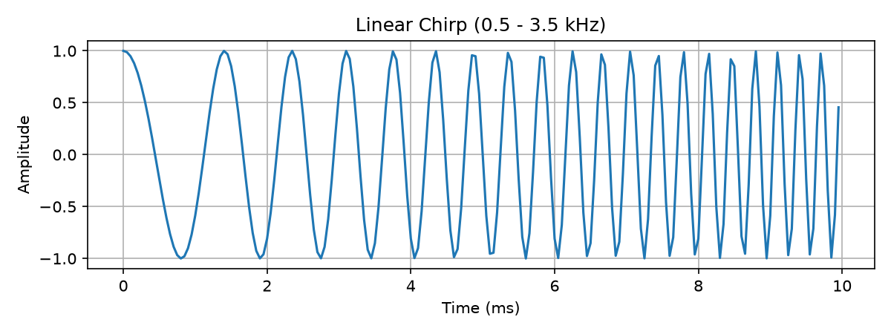
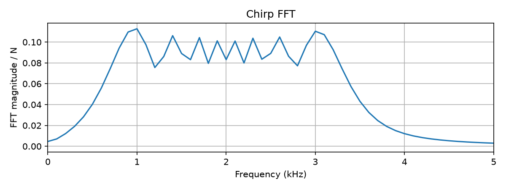
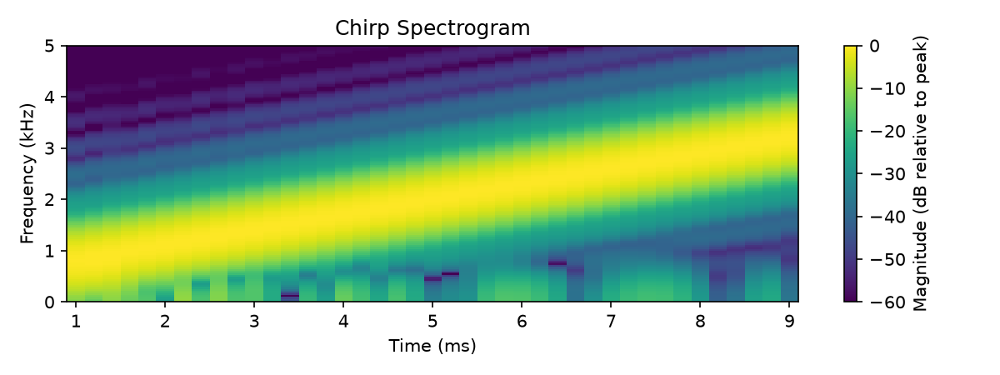

# Chirp outputs

The pulse is a linear frequency-modulated cosine:

```math
x(t) = \cos\left(2\pi\left[f_0 t + \frac{f_1-f_0}{2T}t^2\right]\right),
\qquad 0 \leq t < T.
```

Its instantaneous frequency rises linearly:

```math
f(t) = f_0 + \frac{f_1-f_0}{T}t.
```

Here, \(f_0 = 500\) Hz, \(f_1 = 3500\) Hz, and \(T = 0.01\) s. Time is
measured in seconds, so the frequency increases at 300,000 Hz/s. The pulse
is sampled at 20,000 samples/s.

## Time-domain pulse

The waveform oscillates more rapidly as time increases.



## FFT

The FFT shows the frequency content of the entire pulse, but not when each
frequency occurs. Magnitude is the absolute FFT divided by the sample count.



## Spectrogram

The spectrogram analyzes overlapping 2 ms windows. Its rising band shows the
frequency sweep; the colors show magnitude in dB relative to the peak. The
window length limits time and frequency resolution, so the band has some width.


